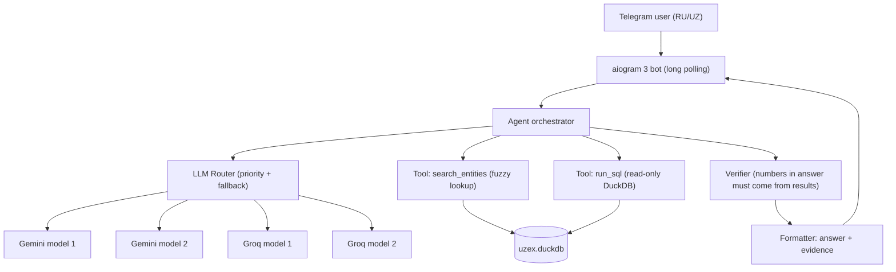

# UZEX Hackathon: Telegram AI Agent, Implementation Plan

**Goal:** A Telegram bot that answers RU/UZ questions about 500k exchange deals. Answers must be exact and backed by data, and the bot must **never make anything up**. It runs on free Gemini and Groq models, with automatic fallback between models and providers.

**Deadline:** Nov 5, 18:00 (Tashkent), about 24h from now. **Project dir:** `C:\Dev\uzex_agent`

---

## 0. Scoring → design decisions

| Rubric item | Points | What we build for it |
|---|---|---|
| Correct answers (10 × 6) | 60 | Text-to-SQL over a cleaned DuckDB database. Python computes the numbers, the LLM never does arithmetic |
| Hallucination = disqualification | ∞ | The final answer is built **only** from SQL results. Empty result → fixed "no data" reply. A number check runs before sending |
| Prototype quality | 20 | Every answer shows its **evidence**: filters used, row count, the SQL (collapsible), sample deal numbers. RU/UZ auto-detected. Target under 15s |
| Solution description | 20 | `SOLUTION.md` covering architecture, LLM router, verification method, and test results |

---

## 1. Architecture



**Stack:** Python 3.12, `duckdb`, `aiogram` 3.x, `openai` SDK (works with **both** Groq and Gemini through their OpenAI-compatible endpoints, so one client handles both), `rapidfuzz`, `pyyaml`, `python-dotenv`.

```
C:\Dev\uzex_agent\
├── .env                  # GEMINI_API_KEY(s), GROQ_API_KEY(s), TELEGRAM_BOT_TOKEN
├── config.yaml           # model priority list, timeouts, cooldowns
├── data/uzex.duckdb      # built once by ETL
├── etl/build_db.py       # CSV → cleaned DuckDB
├── etl/normalize.py      # product / region / company normalization
├── agent/llm_router.py   # provider fallback chain
├── agent/prompts.py      # system prompt, schema, few-shot examples
├── agent/tools.py        # search_entities, run_sql (guarded)
├── agent/orchestrator.py # the agent loop
├── agent/verifier.py     # anti-hallucination checks
├── agent/formatter.py    # number formatting, RU/UZ templates, evidence block
├── bot/main.py           # Telegram handlers
├── tests/questions.yaml  # ~40 RU/UZ test questions + expected answers
├── tests/run_eval.py     # batch evaluation + router stress test
└── SOLUTION.md           # write-up for the submission form
```

---

## 2. Data layer (ETL → DuckDB)

DuckDB loads all 158 MB of CSVs in a few seconds, handles analytic queries over 500k rows in milliseconds, and is a single file.

### 2.1 Tables (English snake_case columns, so the LLM writes SQL more reliably)

| Table | Source | Key cleaning |
|---|---|---|
| `deals` | 5 × `deals_*.csv` (500k) | `amount` / `start_price`: strip spaces → DOUBLE; dates `DD.MM.YYYY` → DATE; `deal_ts` TIMESTAMP; `year`, `month` columns |
| `contracts` | `contracts.csv` (6,616) | numeric `base_price`, `deposit_pct` (from "10 %"); dates; `currency_code` ('UZS'/'USD') |
| `participants` | `participants.csv` (14,392) | `name_norm` (lowercase, quotes and legal forms stripped, Cyrillic→Latin transliteration for search) |
| `brokers` | `brokers.csv` (120) | same name normalization |
| `usd_rates` | `usd_rates.csv` | DATE + DOUBLE |
| `regions` | built by hand (14 rows) | `region_uz` (deals/participants) ↔ `region_ru` (contracts) ↔ aliases ("Ташкент", "Toshkent", "Фергана", ...) |

### 2.2 Precomputed fields on `deals` (so the LLM can't get the formulas wrong)
- `volume_units = quantity * lot`
- `unit_price = amount / (quantity * lot)`
- `currency` (joined from contract)
- `usd_rate` (rate on the deal date)
- `amount_uzs = amount` if UZS, else `amount * usd_rate`
- `amount_usd = amount` if USD, else `amount / usd_rate`
- `is_cancelled = status = 'Аннулирован(Не оплачен)'`
- `delivered_units = delivered * lot`
- contract fields joined in: `product_name`, `product_canonical`, `product_base`, `hs_code`, `category`, `industry`, `product_group`

> [!IMPORTANT]
> The view `deals_full` joins deals + contracts + seller/buyer names + broker names. The LLM queries mostly this **one** wide view, so it rarely has to write joins, which is the biggest source of SQL errors.

### 2.3 Product normalization (the hardest data problem)
There are 230 raw product names with seller-specific spelling (`ХЛОПОК СЫРЕЦ (СПОТ) II СОРТ I КЛАСС` vs `Хлопок-сырец (спот) 2 сорт 1-класс`). We add three levels:
1. `product_name`: raw text as written.
2. `product_canonical`: rule-based cleanup: lowercase, `ё→е`, hyphen/space unification, `I/II/III → 1/2/3`, `первый/второй/третий/высший сорт` unification, `1-сорта → 1 сорт`. Collapses 230 names to roughly 100.
3. `product_base`: commodity family (about 45 values, e.g. `хлопок-сырец`, `мука пшеничная`, `цемент`, `бензин`, `полиэтилен`, `арматура`). Comes from a hand-checked keyword mapping table; I'll print every mapping for review.

`sort`, `class`, `grade/mark` (e.g. АИ-92, ЦЕМ II/А-Ш 32,5Н) go into separate columns where they can be parsed.

### 2.4 Validation script
After the build, assert row counts per year (84,299 / 93,985 / 106,647 / 115,763 / 99,306), no NULL amounts, every contract/participant/broker FK resolves, and every date falls in its range.

---

## 3. LLM Router (automatic model and provider switching)

### 3.1 Config (`config.yaml`), priority order, editable without code changes
```yaml
providers:
  gemini: { base_url: https://generativelanguage.googleapis.com/v1beta/openai/, keys_env: [GEMINI_API_KEY] }
  groq:   { base_url: https://api.groq.com/openai/v1, keys_env: [GROQ_API_KEY] }
chain:   # tried top → bottom
  - { provider: gemini, model: gemini-2.5-flash }
  - { provider: groq,   model: openai/gpt-oss-120b }
  - { provider: groq,   model: llama-3.3-70b-versatile }
  - { provider: gemini, model: gemini-2.5-flash-lite }
  - { provider: groq,   model: qwen/qwen3-32b }
timeouts: { per_call_s: 25, total_budget_s: 70 }
```
> [!NOTE]
> Model names change often. At startup, `scripts/check_models.py` calls each provider's `/models` endpoint and sends a ping prompt. Any configured model that is missing or erroring gets reported and skipped automatically.

### 3.2 Switching logic
- **Per (provider, key, model) health state**: `ok` / `cooldown_until`.
- **Error classification:**
  - `429 rate limit` → cooldown that respects the `Retry-After` header (default 60s; on daily-quota messages, cooldown until midnight Pacific time), then try the **next key** of the same provider, then the next chain entry.
  - `5xx` / timeout / connection error → 30s cooldown, next entry.
  - `400` context too long → next entry (a larger-context model).
  - Invalid/unparseable output (bad JSON or tool call) → one retry on the same model, then next entry.
  - `401/403` → disable that key for the session and log loudly.
- **Global time budget:** if 70s go by without an answer, return a safe "please retry" message instead of risking the 90s limit.
- **Logging:** every call records provider, model, latency, tokens, and outcome to `logs/llm_calls.jsonl`. The `/status` bot command shows chain health, which helps during the live demo and for the write-up.
- **Token economy:** a compact schema prompt (around 2.5k tokens) and SQL results truncated to 30 rows / 4k chars, so each question costs about 6–12k tokens. That fits Groq's per-minute token limits.

### 3.3 Quota protection (one Gemini key + one Groq key, free tier)
- **Answer cache** (SQLite, keyed by normalized question): when judges repeat a question, no LLM call is made.
- **Deterministic fast paths** (no LLM): deal lookup by number ("сделка №412334"), USD rate on a date.
- **Per-model daily counters** in `logs/usage.json`. When a model passes ~80% of its daily limit, the router demotes it so headroom stays for judging.
- **Test budget:** run the heavy eval loop on Nov 4. On Nov 5, before 18:00, do only a small smoke test. Gemini free quotas reset at midnight Pacific time, which is 13:00 Tashkent, so we start judging with a fresh daily quota.
- **Optional extra provider:** a free Cerebras or OpenRouter key adds a third provider to the chain with no code changes.

---

## 4. Agent pipeline (per question)

A bounded tool-calling loop: **at most 6 LLM calls**, normally 2–3.

1. **Language detect** (no LLM): Cyrillic with ў/қ/ғ/ҳ or Latin with o'/g'/sh → UZ, else RU. Replies use the same language.
2. **Plan + entity resolution:** the LLM gets the schema, enum values, `product_base` list, region list, and few-shot examples, then calls tools:
   - `search_entities(type, text)` → fuzzy match (rapidfuzz plus transliteration) over companies, brokers, products, regions. Returns the top 5 with exact IDs (INN, broker code, product_canonical).
   - `run_sql(query)` → see guardrails below.
3. **SQL self-correction:** on a SQL error, the error text goes back to the LLM (up to 2 retries).
4. **Final answer:** the LLM writes a short answer in JSON: `{answer_text, used_values[], sql, not_found: bool}`.
5. **Verifier** (section 5) → **Formatter** → Telegram.

### SQL guardrails (`run_sql`)
- Read-only DuckDB connection; only one `SELECT`/`WITH` statement allowed (parsed check, with `INSERT/UPDATE/COPY/ATTACH/PRAGMA` blocked).
- Automatic `LIMIT 200` if none given; 10s query timeout.
- Returns columns, row count, and the first 30 rows, plus aggregates flagged.

### Prompt contents (`prompts.py`)
- Schema of `deals_full`, `participants`, `brokers`, `usd_rates`, `contracts` with one-line descriptions in RU.
- **Business rules** taken from the README:
  - Cancelled deals are excluded by default from "total sales/volume" questions, and the answer says so explicitly.
  - Mixed currencies are never summed raw; use `amount_uzs` or `amount_usd`.
  - Volume = `volume_units`, with the unit of measure always stated.
  - Status definitions.
  - Data covers 03.01.2022–30.10.2026. Questions outside that range get "no data".
- ~15 few-shot Q→SQL examples (RU and UZ): top buyers, total volume by product/region/year, average price, broker rankings, deal lookup by number, export share, cancellations, delivery delays (`delivery_date - payment_date` vs `delivery_term`), USD rate on a date.

---

## 5. Anti-hallucination (the disqualification risk)

1. **Data-only answers:** the LLM gets SQL results and nothing else, and the prompt forbids outside knowledge.
2. **Empty result rule:** if the final SQL returns 0 rows, or an entity lookup finds no match above the threshold, the bot answers **with a fixed template** and the LLM's text is ignored:
   - RU: «В данных нет информации по этому запросу.» plus what was searched
   - UZ: «Maʼlumotlarda bu so‘rov bo‘yicha javob yo‘q.»
3. **Numeric verifier:** every number in `answer_text` must match a value in the SQL results (within rounding tolerance), the question itself, or a whitelist (dates, years). Same check for company/broker names and INNs. On failure: one regeneration, and if it fails again, the bot sends a deterministic answer built from the raw result table.
4. **Python formats numbers** (`1 234 567,89 сум`), so the LLM doesn't round or rewrite them.
5. **Ambiguity handling:** if "мука" matches 20 variants, the agent either aggregates all of them and says so, or lists the variants. It never picks one silently.
6. **Out-of-scope questions** (weather, real companies, dates after 30.10.2026) → polite refusal, no data invented.

---

## 6. Telegram bot (aiogram 3)

- `/start`: bilingual greeting plus 4 example questions as buttons.
- Free text → "⏳ Ищу в данных..." placeholder, then edited with the answer (feels fast).
- **Answer layout:**
  ```
  <answer, 1–4 sentences, exact numbers>

  📊 Основание / Asos:
  • Фильтры: товар = хлопок-сырец, год = 2025, без аннулированных
  • Найдено сделок: 1 284
  • Примеры сделок: №412 334, №415 901 …
  ▸ SQL (spoiler / expandable blockquote)
  ⚙️ gemini-2.5-flash · 4.2 s
  ```
- `/status` (router health), `/help`.
- Long polling (no webhook or public URL needed). Per-user rate limit and global concurrency limit (3 parallel questions) so judges testing at the same time don't burn through API quotas.
- Global exception handler: the user always gets *some* reply, never silence.

---

## 7. Hosting (bot must be online from Nov 5, 18:00 through judging)

| Option | Pros | Cons |
|---|---|---|
| **A. Your PC** (run `python -m bot.main`, Windows sleep disabled) | zero setup | dies if the PC sleeps, reboots, or loses internet |
| **B. Free/cheap VPS or Railway/Render/Fly.io** worker | always on | 15–30 min setup; DuckDB file (~150 MB) must be uploaded or built on the server |

Recommendation: develop locally, then deploy to **B** with **A** as a hot backup. Only one polling instance may run per bot token, so the backup stays stopped unless needed.

---

## 8. Testing & verification

1. **ETL tests:** row counts, FK integrity, spot checks against the raw CSV (e.g. deal 100001 amount = 304 547 938.4).
2. **Golden set `tests/questions.yaml`:** ~40 questions (half RU, half UZ) with expected answers computed by **hand-written SQL**. Types: lookups, sums, top-N, averages, date ranges, currency conversion, statuses, **and at least 10 "trap" questions whose answers are not in the data** (nonexistent company, 2021 data, a product never traded, a real-world fact).
3. `run_eval.py` reports accuracy, hallucination count (**must be 0**), latency p50/p95, and which models answered.
4. **Router chaos test:** force failures (bad key, simulated 429, timeout) and confirm fallback works and the bot still answers within 70s.
5. **Load test:** 10 questions back-to-back, then 3 in parallel, to confirm we stay under rate limits.

---

## 9. Timeline (≈ 24h budget)

| # | Phase | Est. |
|---|---|---|
| 1 | Project scaffold, `.env`, model availability check | 0.5h |
| 2 | ETL + normalization + validation | 2.5h |
| 3 | LLM router + chaos test | 1.5h |
| 4 | Tools + prompts + orchestrator | 3h |
| 5 | Verifier + formatter (RU/UZ) | 1.5h |
| 6 | Telegram bot | 1h |
| 7 | Golden test set + eval loop + prompt tuning | 3–4h |
| 8 | Deploy + `SOLUTION.md` + form submission (**submit an early working version by ~14:00 Nov 5**, then resubmit improvements) | 1.5h |

---

## Decisions (answered by the user on 2026-11-04)

1. Telegram bot token: not created yet. Give the @BotFather steps in Phase 6.
2. Hosting: the user's Hostinger server (option B), with the local PC as backup.
3. API keys: 1 Gemini + 1 Groq, free models only. Quota protection is in section 3.3.
4. Show SQL to judges: yes (collapsible).
5. Cancelled deals: excluded from totals by default, and the answer says so.
