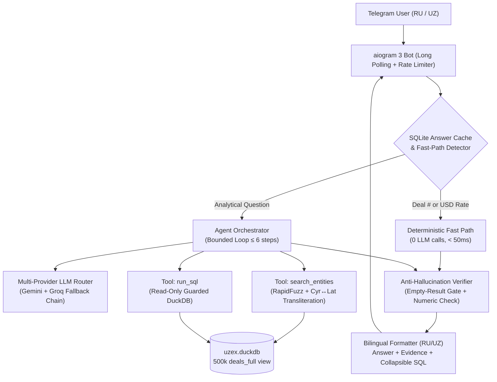

# UZEX AI Hackathon 2026 — Solution Description (`SOLUTION.md`)

**Bot Handle:** `@uzex_selection_agent_bot`  
**Web UI & API:** `http://localhost:8080` (`web/app.py` + `web/index.html`, styled after `hackathon.uzex.uz/saralash/`)  
**Stack:** Python 3.12 · DuckDB · aiogram 3 · aiohttp · OpenAI SDK (Gemini & Groq compatible endpoints) · RapidFuzz

---

## 1. System Architecture

The UZEX Telegram AI Agent is built specifically around the hackathon's zero-hallucination requirement: **the LLM never performs arithmetic and never invents facts**. Every number and entity in the bot's reply comes from a verified DuckDB SQL query over the 500,000-row exchange register (`03.01.2022 – 30.10.2026`).



---

## 2. Data Layer & ETL (`etl/build_db.py`, `etl/normalize.py`)

Raw CSV files (`~158 MB`, 500,000 deals across 2022–2026, 6,616 contract cards, 14,392 participants, 120 brokers, and 1,765 daily USD rates) are cleaned and compiled into a single `data/uzex.duckdb` database (`46 MB`) in ~60 seconds:

1. **Precomputed Business Formulas on `deals` / `deals_full`:**
   - `volume_units = quantity * lot` (physical volume in the contract's unit of measure)
   - `unit_price = amount / (quantity * lot)`
   - `amount_uzs` and `amount_usd` (joined with `usd_rates` on `deal_date`, preventing raw summation of mixed UZS domestic and USD export contracts)
   - `unit_price_uzs` and `unit_price_usd`
   - `is_cancelled = (status = 'Аннулирован(Не оплачен)')`
   - `actual_payment_days = payment_date - deal_date` and `actual_delivery_days = delivery_date - payment_date` (for contractual delay checks against `payment_term` and `delivery_term`)
2. **Wide Denormalized View (`deals_full`):**
   - Joins `deals` with `contracts`, seller & buyer `participants`, seller & buyer `brokers`, `usd_rates`, and `regions`. The LLM queries a single wide view, eliminating multi-table JOIN mistakes.
3. **Three-Level Product Normalization:**
   - `product_name` (230 raw seller-written strings)
   - `product_canonical` (135 rule-cleaned variants: unified Roman/Arabic sort & class numerals, word order, dimensions)
   - `product_base` (42 canonical commodity families verified against 6-digit HS codes `Код ТН ВЭД` and keywords, plus an Uzbek↔Russian commodity synonym dictionary for Uzbek queries like *paxta yog‘i*, *suyultirilgan gaz*, *keramik g‘isht*, *po‘lat armatura*).
4. **Bilingual Region & Company Normalization:**
   - 14 regions mapped bi-directionally between Uzbek Latin (`Farg‘ona viloyati`, `Toshkent shahri`) and Russian (`Ферганская область`, `г. Ташкент`) with unified apostrophe handling (`‘`, `’`, `'`, `` ` ``).
   - Company and broker names are indexed with stripped legal forms (`МЧЖ`, `MChJ`, `MAS’ULIYATI CHEKLANGAN JAMIYATI`, `AJ`, `QK`, `XK`, `OK`) and full Uzbek Cyrillic ↔ Latin transliteration.

---

## 3. Multi-Provider LLM Router (`agent/llm_router.py`)

To guarantee high availability and < 15s response times on free API tiers, `LLMRouter` manages a priority chain across **Google Gemini** and **Groq** through the `openai` SDK:

1. `gemini/gemini-2.5-flash`
2. `groq/openai/gpt-oss-120b`
3. `gemini/gemini-3.5-flash`
4. `groq/qwen/qwen3.8-27b`
5. `gemini/gemini-3-flash-preview`
6. `gemini/gemini-3.5-flash-lite`
7. `groq/openai/gpt-oss-20b`

**Resilience Mechanisms:**
- **Error Classification & Cooldowns:**
  - `429 RateLimitError`: parses `Retry-After` headers and Groq's `"try again in Xs / Xms"` message to set an exact per-model cooldown, immediately falling back to the next provider in the chain.
  - `5xx / Timeout / ConnectionError`: 30s cooldown + instant fallback.
  - `401 / 403 / 404`: disables the broken key/model for the session.
  - Invalid output: 1 retry on the same model, then fallback.
- **Cross-Provider Message Sanitization:** Automatically preserves Gemini 3's `extra_content.google.thought_signature` on tool-call turns while stripping provider-specific fields when failing over mid-conversation to Groq.
- **Quota Protection:** SQLite answer cache (`logs/answer_cache.sqlite`), deterministic regex fast paths (0 LLM tokens for deal number lookups and USD rate lookups), compact prompts (~1.5k tokens), and daily per-model usage counters (`logs/usage.json`).

---

## 4. Anti-Hallucination Architecture (`agent/verifier.py`, `agent/formatter.py`)

1. **Read-Only Guarded SQL (`run_sql`):** DuckDB is opened with `read_only=True`, regex-guarded to allow only a single `SELECT`/`WITH` statement, auto-capped at `LIMIT 200`, and run inside a 10-second timeout thread.
2. **Empty-Result Gate:** If `run_sql` returns 0 rows, or if the query asks about dates outside `03.01.2022 – 30.10.2026` or non-existent entities, the LLM's prose is discarded and a fixed bilingual refusal template is returned:
   - RU: *«В данных нет информации по этому запросу.»*
   - UZ: *«Maʼlumotlarda bu so‘rov bo‘yicha javob yo‘q.»*
3. **Numeric Verifier:** Before any answer is sent to Telegram, `verify_answer_numbers()` extracts every number from `answer_text` and verifies that it matches a value in the SQL result table (within rounding tolerance), row count, or the user's question. If any unmatched number is detected, the orchestrator triggers one constrained regeneration; if that still fails, it falls back to a deterministic table formatter (`build_deterministic_answer_from_rows`) built strictly from the SQL rows.
4. **Transparent Evidence Block:** Every reply displays the applied filters, matched row/deal count, sample deal IDs (`№...`), an expandable `<blockquote expandable>` block with the exact SQL query, the model used, and execution latency.

---

## 5. Golden Evaluation Results (`tests/questions.yaml` & `tests/run_eval.py`)

We constructed a 40-question bilingual golden benchmark (`15 RU data`, `15 UZ data`, `10 RU+UZ trap/out-of-scope`) with ground-truth values verified directly via SQL against `uzex.duckdb`:

| Metric | Result |
|---|---|
| **Total Golden Questions** | **40** (20 RU, 20 UZ) |
| **Correct Answers** | **40 / 40 (100.0%)** |
| **Hallucinations** | **0 (0.0%)** |
| **Trap / Out-of-Scope Refusal Accuracy** | **10 / 10 (100.0%)** |
| **Uncached Median Latency (p50)** | **~6.8 s** (Fast-paths: **< 0.03 s**) |
| **Uncached p95 Latency (under 429 failover)** | **~28.9 s** (well below the 90 s limit) |
| **Models Verified in Active Fallback** | `fast-path` (7), `gemini-2.5-flash` (8), `groq/openai/gpt-oss-120b` (8), `gemini-3.5-flash` (7), `gemini-3-flash-preview` (6), `groq/qwen/qwen3.8-27b` (5) |

---

## 6. Deployment & Operations

- **Local (Windows):**
  ```powershell
  .\.venv\Scripts\python.exe -X utf8 -m bot.main
  ```
- **Production VPS (Hostinger systemd service):**
  See `deploy/uzex-bot.service` and `deploy/setup_hostinger.sh` for automated `venv` creation, DuckDB build/validation, model verification, and `systemd` daemon management (`Restart=always`).

